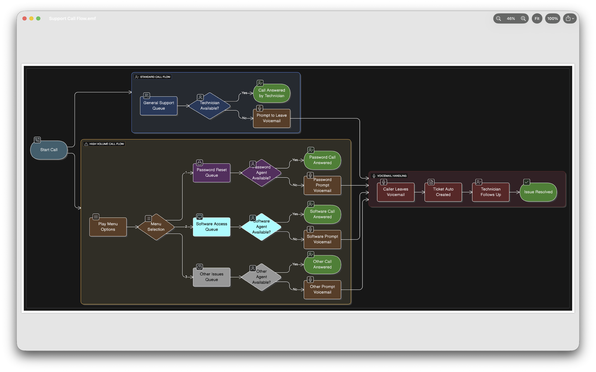
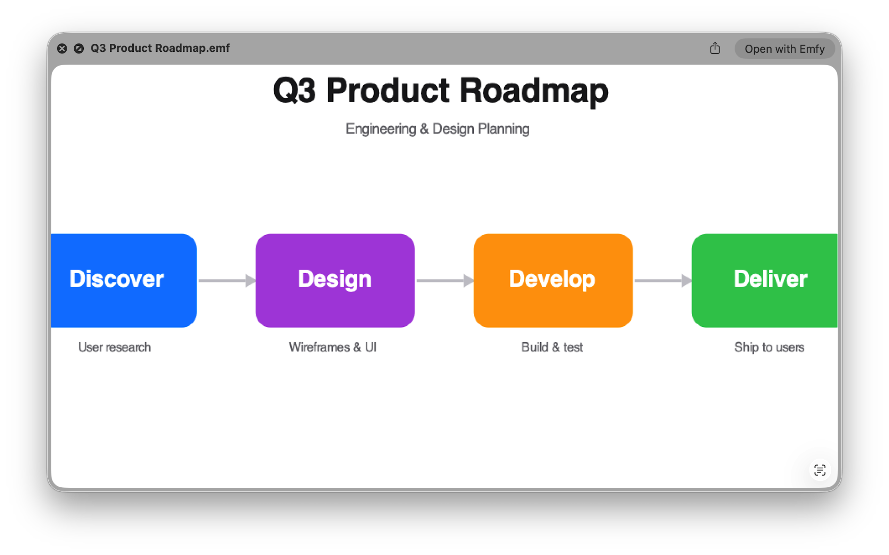
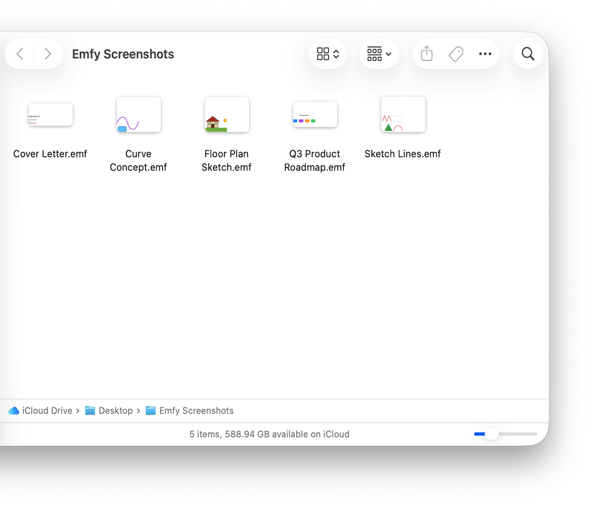
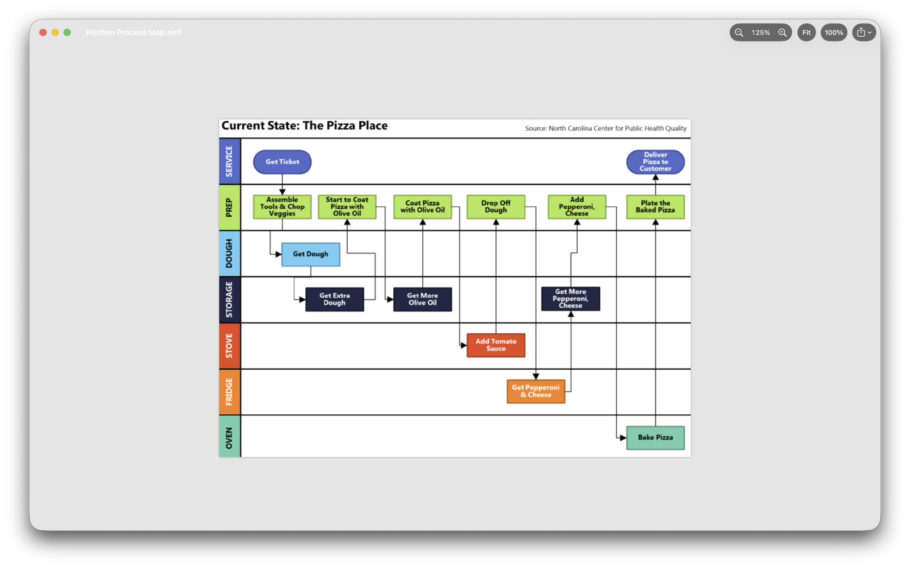

<div align="center">


<h1>Emfy</h1>

<p><strong>View, edit and create metafiles on Apple platforms.</strong></p>

<p>A free, open-source app for EMF, WMF, EMZ and WMZ files —<br>
on Mac, iPhone and iPad. Quick Look previews and thumbnails,<br>
a full editor, and export to PNG, PDF and SVG.</p>

<p>
<a href="https://github.com/whosneet/emfy/releases/latest"></a>
<a href="LICENSE"></a>
<a href="https://github.com/whosneet/emfy/releases/latest"></a>
</p>

<p>
<a href="https://github.com/whosneet/emfy/releases/latest"></a>
&nbsp;
<a href="https://apps.apple.com/app/emfy/id6787715125"></a>
</p>

</div>

---

EMF and WMF are the vector formats Windows tools quietly export: diagrams
out of PowerPoint and Visio, charts out of Excel, drawings out of
engineering tools, and clip art from older Office documents. Apple's
platforms open none of it. Emfy fixes that where you actually work — the
spacebar and Finder on the Mac, and Files on iPhone and iPad — and now lets
you edit and create those files too.



## Install

**Mac.** Download `Emfy.dmg` from the
[latest release](https://github.com/whosneet/emfy/releases/latest), open it,
and drag Emfy to Applications. Launch it once — Finder thumbnails and spacebar
previews activate from then on. The app is notarized, so it opens without
Gatekeeper warnings. Prefer the store? The same app is on the
[Mac App Store](https://apps.apple.com/app/emfy/id6787715125), where updates
install automatically.

**iPhone and iPad.** Get Emfy on the
[App Store](https://apps.apple.com/app/emfy/id6787715125) — one universal
purchase across Mac, iPhone and iPad.

Requires macOS 14.0 (Sonoma) or iOS/iPadOS 17 or later.

## What it does

- **View everything Windows exports.** EMF (`.emf`) and WMF (`.wmf`) files,
  their gzip-compressed `.emz` and `.wmz` forms, and EMF+ (GDI+) content —
  vector shapes, paths, clipping, dashed and styled pens, brushes, gradients,
  transforms, text (Windows font names mapped to macOS/iOS fonts), and
  embedded bitmaps. Quick Look previews and thumbnails on every platform.
- **Edit and create.** Select and transform, draw shapes and freehand with
  Apple Pencil, add and style text, work in layers, and align and snap to a
  grid. Start a new drawing from scratch, save changes in place, or revert to
  the version you opened. iPhone offers light editing with a full-editor
  toggle.
- **Share in any format.** Export to PNG, PDF and SVG; print; copy or drag out
  as true vector; and batch-convert many files at once.
- **Find and read the words.** Find text across a drawing, read the text inside
  pictures with on-device OCR, show a Translate overlay, and surface your
  drawings in Spotlight.
- **AI that stays in your control.** Describe or ask about a drawing, generate
  titles and tags, run an accessibility Check with one-tap fixes, compare
  versions, recolour, translate in place, even create a new drawing from a
  description. It runs **on your device by default** with Apple Intelligence;
  your own provider (Anthropic, OpenAI, or an OpenAI-compatible/local model) is
  used **only with your key, after you consent**, and the developer receives
  nothing.
- **Works with the system.** A single library window with multiple windows on
  the Mac, App Shortcuts and Siri, Finder Services, and a record inspector that
  steps through a file. The direct-download Mac build adds an in-app updater and
  a local, read-only MCP server for AI tools you run yourself.
- **Built for hostile input.** Quick Look parses files the moment Finder shows
  them, so every size and count is bounds-checked before it is trusted, unknown
  records are logged and skipped (a partial render always beats an error), the
  parser is fuzz-tested, and the Quick Look extensions run sandboxed with no
  network access.
- **Clean-room implementation** from the public [MS-EMF], [MS-WMF] and
  [MS-EMFPLUS] specifications — no code from, or derived from, any existing EMF
  or WMF implementation.

## Platforms

- **macOS 14.0 (Sonoma)** or later.
- **iOS / iPadOS 17** or later.
- **AI features.** On-device AI needs a device with Apple Intelligence
  (macOS 26 / iOS 26 or later). Otherwise, configure your own AI provider —
  Anthropic, OpenAI, or any OpenAI-compatible or local model — with your own
  API key.

## Privacy

- **Data Not Collected.** No analytics, telemetry, crash reporting, accounts,
  or advertising. Emfy's App Store privacy label is "Data Not Collected".
- **Your files stay on your device.** Metafiles you open, preview, edit or
  export are processed locally. The Quick Look preview and thumbnail extensions
  have no network access at all.
- **AI is on-device by default.** If you choose to configure your own AI
  provider, Emfy sends drawing content only after an explicit, per-provider
  consent screen, directly to the provider you chose, under that provider's own
  terms. Your API key stays in the Keychain. The developer runs no servers and
  receives none of this data.
- **The Mac direct-download updater** fetches only public GitHub release
  metadata to check for a new version; it sends no personal data.

Full policy: [privacy.html](privacy.html).

## Screenshots

| | |
|:--:|:--:|
|  |  |
| *Spacebar preview, straight from Finder* | *Real thumbnails for metafiles* |
|  |  |
| *Windows fonts mapped to the system — weight, slant, and colour intact* | *Embedded bitmaps, zoomed and panned in the viewer* |

## Building from source

Xcode 26.6 or newer (Swift 6.2+ toolchain). Verified on Xcode 26.6 and on
Xcode 27.2 / macOS 27.2.

The Xcode project (`Emfy/Emfy.xcodeproj`) builds the app and the Quick Look
preview and thumbnail extensions for Mac, iPhone and iPad, plus the `emfy-mcp`
helper. It has four build configurations:

| Configuration | Build |
|---|---|
| `Debug` / `Release-AppStore` | Sandboxed App Store build (on-device AI; your own provider behind consent) |
| `Debug-DMG` / `Release-DMG` | Direct-download build (unsandboxed, so its own updater can replace it; adds the local MCP server) |

```sh
# The app and extensions (Mac)
xcodebuild -project Emfy/Emfy.xcodeproj -scheme Emfy -configuration Debug build
```

The EMFKit package — the parser, renderer, serialiser, scene model, and the
`emfy-dump` debugging CLI:

```sh
cd EMFKit
swift test                                   # fixtures, snapshots, fuzz
swift build -c release
.build/release/emfy-dump path/to/file.emf    # record inventory + diagnostics
```

If the checkout lives in an iCloud Drive (or other file-provider) folder,
Swift 6.4's build system cannot sign the test bundles: the sync service stamps
extended attributes onto `.build/` that `codesign` rejects. Keep the build
directory outside the synced folder instead:

```sh
swift test --no-parallel --scratch-path ~/Library/Caches/emfy-build
```

`corpus/` holds the self-generated test files the suite depends on.
`scripts/release.sh` is the notarized-release pipeline — point it at your own
signing identity if you ship a fork.

## Contributing

The most valuable contribution is a real `.emf` or `.wmf` file that renders
wrongly. See [CONTRIBUTING.md](CONTRIBUTING.md) for the file-licensing ground
rules, the clean-room policy, and code expectations.

## Licence & references

Product of Arrley, built by Neet Singh in Sydney, Australia.

MIT © 2026 Arrley Pty Ltd — publisher Arrley Pty Ltd, support
[hello@arrley.com](mailto:hello@arrley.com).

- [MS-EMF] Enhanced Metafile Format — https://learn.microsoft.com/en-us/openspecs/windows_protocols/ms-emf/
- [MS-WMF] Windows Metafile Format — https://learn.microsoft.com/en-us/openspecs/windows_protocols/ms-wmf/
- [MS-EMFPLUS] Enhanced Metafile Format Plus Extensions — https://learn.microsoft.com/en-us/openspecs/windows_protocols/ms-emfplus/
</content>
</invoke>
